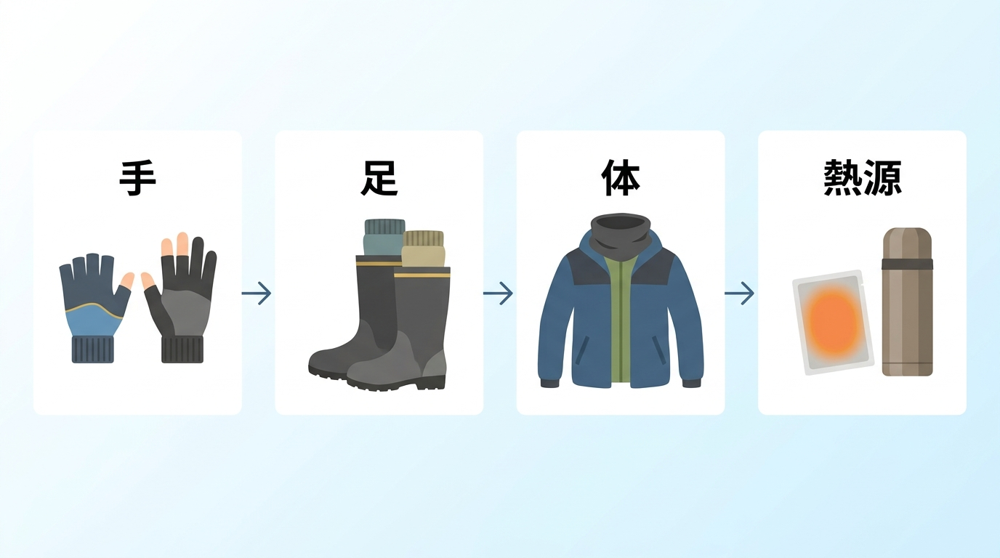

import BlogCard from "@components/BlogCard.astro";
import TackleCard from "@components/TackleCard.astro";

冬の浜名湖で釣りをためらう理由は、魚よりも寒さかもしれません。

とくに遠州の空っ風が吹く日は、気温の数字だけで服を選ぶと、手元の作業や竿先を待つ時間がつらくなります。

寒さを減らせれば、慌てて片付けずに一つの穴を探ったり、もう一度仕掛けを流したりする余裕が生まれます。

冬支度で優先したいのは、<strong>手と足を守り、風を避けて、無理のない時間だけ釣ること</strong>です。

ブラックフライデーは、その準備を始めるきっかけにしましょう。

この記事では、初めて冬の釣りに出る人が、必要な装備だけを順番に揃えられるように整理します。

## 結論：防寒は手→足→体→熱源の順で不足を埋める

普段の冬服と風を遮る上着があるなら、追加する順番は<strong>手→足→体→熱源</strong>です。

手が冷えるとエサ付けや糸結びが難しくなり、足が冷えると、置き竿で待つ時間そのものが負担になります。

まず釣りの動作に関わる部分を整え、それでも足りないところへインナーや防寒スーツを足していきます。

これは、体を薄着のままにして手袋だけ買えばよい、という順番ではありません。

風を通す上着しかない場合は、体の防風も最初に整えてください。

| 順番 | 確かめること | 足りないときに用意するもの |
| :--- | :--- | :--- |
| 1：手 | 手袋を着けたまま竿や仕掛けを扱えるか | インナーグローブ、3本の指先を出せる手袋 |
| 2：足 | 待っている間に足先が冷えないか | 厚手の靴下、防寒ブーツ |
| 3：体 | 風が入り込まず、汗を調節できるか | インナー上下、中間着、防寒スーツ、首の防風 |
| 4：熱源 | 休憩や待ち時間を補助できるか | カイロ、温かい飲み物を入れた保温ボトル |

カイロは服装を補うものなので、熱源を増やす前に、袖口や首元から入る風を止めましょう。

## ブラックフライデー前に候補を決め、必要なものは先に用意する

ブラックフライデーは例年11月下旬の買い物の機会ですが、<strong>紹介する防寒商品がセール対象になるとは限りません</strong>。

冬支度に使いたい理由は、値下げへの期待だけでなく、12〜1月の釣行前に装備を揃えて試せることです。

手袋やブーツ、防寒着にはサイズがあり、寒くなってから探すと、欲しいサイズや色を選べないことがあります。

早めに候補を決めておけば、配送予定を確かめ、届いたものを重ね着や厚手の靴下と合わせる時間も取れます。

貼るカイロのような消耗品は、釣り以外でも使う予定があれば無駄になりにくい一方、使う見込みのない量を抱える必要はありません。

| 判断 | 当てはまる場合 |
| :--- | :--- |
| 今用意する | 次の釣行までに必要な手袋や防風着がない、靴が合わない、配送に余裕が必要 |
| セールまで待ってよい | 手持ちで釣りに行けて、買い替えや予備を検討している |
| 買わなくてよい | 今の装備で足りる、冬は1回だけで手持ちの服や借りられる装備で対応できる |

1回だけの予定なら、まず暖かい昼に短時間で終える計画にして、専用の防寒スーツや繰り返し使うカイロは保留でかまいません。

手持ちで寒さに対応できないときは、購入だけでなく、天気のよい日への変更も選択肢です。

## 手の防寒：今の手袋に足し、細かな作業には3本カットを選ぶ

### 今ある手袋を生かすならインナーグローブ

手袋がすでにあるなら、買い替える前に、薄手のインナーを重ねられるか確かめます。

重ねた状態で指を曲げ、リールのハンドルを回して、窮屈にならないことが条件です。

今の手袋だけでは保温が足りず、内側に余裕がある場合は、下履き用のおたふくインナーグローブを足す方法があります。

<TackleCard id="winter/otafuku-inner-glove" position="tackle" />

### エサ付けや糸結びには3本の指先を出せるタイプ

仕掛けを結ぶたびに手袋を全部外すのは避けたいところです。

親指・人差し指・中指を出せるタイプなら、手のひらや甲を覆いながら細かな作業を進められます。

エサ付けや糸結びのために着脱を繰り返す人には、指を3本出せるUMIBOZUの裏起毛グローブが候補になります。

<TackleCard id="winter/umibozu-3finger-glove" position="tackle" />

ただし、出ている指先まで暖かくなるわけではありません。

インナーを合わせる場合も、指先を出して作業できるか自宅で試し、濡れたときに替えられる手袋を用意しましょう。

### ルアー釣りなら、指まで覆う手袋も選べる

釣り用の手袋は指先を出すタイプが多いのですが、私はそれだと指がかなり冷たくなるので、指まで覆う普通の手袋に替えました。

ルアー釣りなら、この手袋のままでも困ったことはありません。

一方で、エサを使う釣りでは、エサをつまむたびに手袋が汚れます。

エサ釣りなら指先を出せるタイプ、ルアー釣りなら指まで覆うタイプというように、釣り方で選び分けてください。

## 足の防寒：防寒ブーツは厚手の靴下と一緒に合わせる

### 置き竿で待つ人は足元を先に整える

歩いているときは平気でも、釣り座で動かなくなると足先の冷えが気になりやすくなります。

とくに投げ釣りで長く待つなら、上着をもう1枚増やす前に、今の靴と靴下で足りるかを見直してください。

冬の堤防で置き竿を見守る時間が長く、普段の靴では保温が足りない人には、マズメのウインターブーツMZRB-806が候補です。

<TackleCard id="winter/mazume-winter-boots" position="tackle" />

サイズは普段の靴の数字だけで決めず、<strong>釣りで履く厚手の靴下と合わせて選びます</strong>。

つま先や甲が押されず、かかとが大きく浮かないかを室内で確かめましょう。

靴下を何枚も重ねて窮屈にするより、無理なく収まる組み合わせを優先してください。

防寒ブーツでも、濡れた護岸や不安定な石の上を安全に歩ける保証はありません。

靴底が釣り場の足場に合うかも確認し、初心者は平らで安定した場所から釣りましょう。

## 体の防寒：インナー上下→防寒スーツ→首元の順で整える

### 肌に近いインナーと中間着を見直す

基本は、肌に近いインナー、フリースなどの中間着、風を遮る外側の服を重ねる考え方です。

移動中に暑くなったら上着を調節し、汗をかいたまま釣り座で立ち続けないようにします。

歩いて入る釣り場で汗冷えが気になるなら、吸汗速乾の保温インナーであるサーモデオのハイネックが候補になります。

<TackleCard id="winter/otafuku-thermodeo-highneck" position="tackle" />

下半身も忘れず、ズボンの下には保温用のタイツを合わせます。

上だけ厚着しても膝や太ももが冷えるなら、サーモデオのロングタイツなど、下に足す1枚を検討してください。

上下とも手持ちの冬用インナーで足りるなら、新しく揃え直す必要はありません。

### 初めて上下を揃えるなら手頃な防寒スーツ

インナーを整えても外側から風や水が入り込むなら、防寒スーツの出番です。

冬用の上下がなく、まず一式を用意したい人には、マックの防水防寒スーツが候補になります。

<TackleCard id="winter/makku-bousui-bokan-suit" position="tackle" />

中間着を着た状態でしゃがみ、腕を前に伸ばせるサイズを選んでください。

### 冬に何度も通うなら長く使う1着を選ぶ

これから毎冬通うつもりなら、着心地と動きやすさを確かめて、長く使う1着を選びたいところです。

買い替えを検討している人には、釣具メーカーのダイワRAINMAXウインタースーツDW-3525も候補になります。

<TackleCard id="winter/daiwa-rainmax-winter-suit" position="tackle" />

高い保温性を期待して大きすぎるものを選ぶより、重ね着した状態の寸法と、袖口や裾の収まりを確認しましょう。

### 首元に隙間があるならネックウォーマー

体の重ね着ができていても、襟元が開いたままだと風の入口が残ります。

上着の襟だけでは首を覆えない場合は、防風を組み合わせたおたふくのネックウォーマーJW-124を足す選び方があります。

<TackleCard id="winter/otafuku-neckwarmer-jw124" position="tackle" />

すでに首を覆える装備があるなら、それを使ってかまいません。

防寒着を着たあとにライフジャケットも合わせ、無理なく装着できることを確認してください。

## 熱源と飲み物：カイロは補助に使い、休憩も準備する

### 貼るカイロは使う分だけ用意する

服装を整えたうえで、待ち時間の冷えを補いたいときにカイロを足します。

冬の釣行や日常で繰り返し使う予定があるなら、衣類に貼るホッカイロをまとめて用意しておくと、出発前の買い足しを減らせます。

<TackleCard id="winter/hokkairo-haru-30" position="tackle" />

> [!CAUTION]
> <strong>カイロは低温やけどに注意してください。</strong>
>
> 肌に直接当てず、同じ場所に長時間当てたり、ベルトなどで圧迫したりしないでください。
>
> 熱いと感じたら外し、貼ったまま眠らず、製品の注意書きに従って使います。
>
> 衣類用カイロを、靴の中に入れる用途へ流用しないでください。

使用前に[日本カイロ工業会の低温やけどの注意](https://www.kairo.jp/useful/yakedo/)も確認しておきましょう。

### 充電式とハクキンカイロは、管理できるかで選ぶ

繰り返し釣りに出るなら、充電式カイロも選択肢です。

SAMONICの充電式カイロは温度を調節できる候補ですが、出発前の充電と、釣り場での残量管理が必要になります。

充電式でも低温やけどへの注意は同じで、取扱説明書に沿って使ってください。

ハクキンカイロは、別売りの指定ベンジンを使うタイプです。

長い待ち時間の熱源として検討できますが、燃料を扱う準備まで含めて選ぶ必要があります。

<strong>ベンジンは引火しやすい可燃物なので、給油中は禁煙し、火気から離して扱ってください</strong>。

メーカー指定の燃料と給油量を守り、発熱中の給油はせず、燃料容器の栓や液漏れも確認します。

使用時は専用の袋に入れ、詳しい手順は[ハクキンカイロ公式の使い方](https://hakukin.co.jp/howto/)に従ってください。

初めて冬に1回出る段階なら、充電式と燃料式の両方を買う必要はありません。

### 温かい飲み物は保温ボトルで持っていく

待ち時間の長い釣りでは、竿を安全に置き、風を避けて飲み物を飲む休憩も予定に入れます。

温かい飲み物を持ち歩くボトルがない人には、サーモスFFX-502が候補になります。

<TackleCard id="winter/thermos-ffx-502" position="tackle" />

すでに保温できるボトルがあれば買い足さず、飲むときのやけどに気をつけて使いましょう。

## 釣り方別の必要度：短時間の穴釣りと待つ釣りで変える

装備の量は、狙う魚の名前より<strong>動かずに待つ時間と、水に入るかどうか</strong>で考えると決めやすくなります。

次の表は、基本の冬服と防風を用意したうえでの、買い足しの目安です。

| 釣り方 | 手 | 足 | 体 | 熱源・休憩 |
| :--- | :--- | :--- | :--- | :--- |
| 昼の穴釣り・1〜2時間 | エサ付けできる手袋を優先 | 安定した足場に合う靴と厚手の靴下 | 防風を基本に、移動で暑ければ調節 | 予備のカイロと飲み物、冷える前に終了 |
| 投げ釣り・置き竿で待つ | 仕掛けを扱うとき以外も覆う | 防寒ブーツの優先度が高い | 上下の保温を厚くし、風を遮る | カイロと風を避ける休憩を重視 |
| 夜のメバル・アジング | 細い糸を扱える操作性を優先 | 立つ時間を考え、足先も保温 | インナーと防風着、首元を整える | 短時間で区切り、残量や帰る時刻を確認 |
| ウェーディング・水に立ち込む | 操作性と濡れへの備えが必要 | 通常の防寒ブーツでは代用不可 | 冬用ウェーダーなど専用の備えが前提 | カイロを足して無理に続けない |

ウェーディングは、岸の防寒セットを揃えれば始められる釣りではありません。

初めての冬は岸から始め、水中へ入る装備や安全管理は別に考えてください。

昼の短時間で組み立てたい人は、穴釣りの記事で足場と探り方を確認できます。

<BlogCard slug="winter-anazuri-guide-2026" />

夜のメバル・カサゴを狙う場所や軽い仕掛けの扱い方は、冬のライトゲームの記事で解説しています。

<BlogCard slug="winter-lightgame" />

## 寒さを減らす釣り場選び：空っ風を遮り、車へ戻りやすくする

防寒を買い足す前に見直したいのが、釣り座の向きです。

浜名湖の冬は北西からの空っ風を考え、背後に建物や堤防があって風を遮れる場所を候補にします。

<strong>風裏とは、地形や構造物で風の勢いが弱まる側</strong>のことで、単に風を背負って投げることとは違います。

現地で風が回り込む場合もあるので、着いてから釣り座の風と足場を確かめ、強ければ場所を変えるか見送りましょう。

北西風を踏まえた冬の場所選びと、カレイ・根魚の狙い方は1月の記事にまとめています。

<BlogCard slug="1-month" />

車へ戻りやすいことも、冬の釣り場を選ぶ基準になります。

釣り場ごとに駐車位置や歩く距離が違うので、「すぐ休める」と決めつけず、駐車場と釣り座の関係を確かめてください。

車からの距離やトイレを比べたい人は、ファミリー向けポイントの記事を参考にできます。

<BlogCard slug="family-car-points" />

## セール当日にやること：候補・通知・サイズ・到着日を確認する

当日に初めて商品を探すと、必要性よりセール表示で選びやすくなります。

先に「手袋を足す」「足元を替える」のように困り事を一つ決め、商品名とサイズを控えておきましょう。

1. <strong>候補を絞る</strong>：買う理由と手持ちで代用できない部分を書き、普段の販売条件も確認しておく。
2. <strong>値下げ通知を使う</strong>：[Keepaの価格追跡・通知機能](https://chromewebstore.google.com/detail/keepa-amazon-price-tracke/neebplgakaahbhdphmkckjjcegoiijjo)などで候補を追い、通知が来たら販売ページを確認する。
3. <strong>サイズを確かめる</strong>：リンク先で色・サイズを選び直し、重ね着や厚手の靴下を含めて寸法を合わせる。
4. <strong>販売元と到着日を確認する</strong>：購入時の条件や返品条件を読み、次の釣行までに試せるかを確かめる。

通知が来ても、必要なサイズが違ったり、使う日までに届かなかったりするなら購入を急ぐ理由にはなりません。

対象外だった商品も、次の釣りに不可欠ならセール待ちをやめ、手持ちで足りるなら見送ってかまいません。

防寒以外の釣具も見直したい人は、セールで道具を選ぶ考え方をこちらで整理しています。

<BlogCard slug="amazon-sale-tackle-strategy" />

## まとめ：防寒を整え、冬の浜名湖を短時間から楽しもう

冬の防寒は、一度に全部買うより、<strong>手→足→体→熱源の順で不足を埋める</strong>と判断しやすくなります。

ブラックフライデーを準備のきっかけにしつつ、手持ちで足りるものは残し、必要なサイズと到着日を優先してください。

昼に1〜2時間だけ穴釣りをする、風を遮れる場所で竿を出す、帰りに食事の楽しみを作るなど、冬に出かける理由は長時間の釣りだけではありません。

釣り納めの魚と場所を決めたい人は、12月の記事から次の予定を考えられます。

<BlogCard slug="12-month" />

帰りの食事も含めて楽しみたい人は、冬の釣りと牡蠣グルメを組み合わせるプランも参考にしてください。

<BlogCard slug="travel/hamanako-winter-fishing-oyster-trip" />

牡蠣小屋などの営業・予約条件は、出発前に各施設の公式案内で確認しましょう。

### 安全とマナーを守って、冷える前に帰る

手元の作業がつらい、服や手袋が濡れた、風が強まったときは、買った装備を試すために粘らず切り上げてください。

ライフジャケットを着け、現地の看板と施設・漁協の最新案内を確認し、立入禁止の場所へ入らないことも冬支度の一部です。

カイロの袋や糸くずは持ち帰り、夜は会話や車のドア音を抑えましょう。

目指したいのは、寒さに耐え切る釣りより、次の休みにまた来たくなる余裕を残した釣りです。
