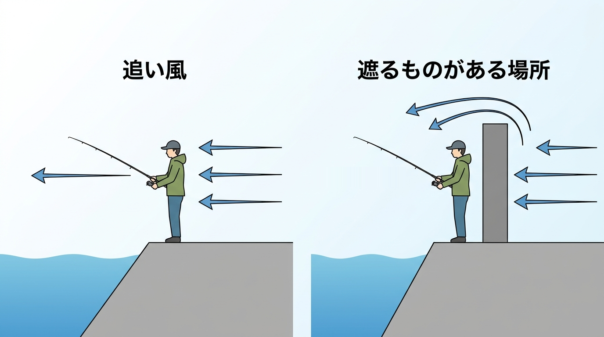

import BlogCard from "@components/BlogCard.astro";
import TackleCard from "@components/TackleCard.astro";

<strong>浜名湖の冬の釣りは、昼ならカサゴの穴釣り、穏やかな夜ならメバル、砂地で待つなら寒カレイ</strong>が中心です。

夏のように幅広い魚を探すより、魚の居場所と釣る時間を絞ると、冬の一日を組み立てやすくなります。

初めての冬釣行なら、足場のよい護岸で昼に短時間だけカサゴを探すプランが始めやすいです。

魚を選ぶ前に風を確かめ、帰る時刻も決めておけば、寒さを我慢するだけの釣りにせずに楽しめます。

## 冬の浜名湖へ行く価値は「短く釣って楽しむ」こと

私が冬にも釣りへ出かけるのは、外に出ないと日の光を浴びる時間が少なくなり過ぎるからです。

釣果だけを目的にしなくても、昼の明るい時間に外へ出る理由になるのが、冬の釣りのよいところです。

冬は一日中竿を出さなくても、狙いを絞った釣りを計画できます。

たとえば昼の暖かい時間に1〜2時間だけ穴釣りをして、暗くなる前に片付ける組み立てなら、夜釣りの準備がない人にも取り入れやすいでしょう。

カサゴは岩や基礎石の隙間、メバルは夜の常夜灯の明暗、カレイは砂地と、狙う場所の違いがはっきりしていることも冬の面白さです。

数釣りだけを目標にせず、底までエサを届けられたか、流れに仕掛けを乗せられたかを確かめながら、一匹とのやり取りを楽しめます。

12月後半は寒さで釣り人が減る傾向があり、夏の賑わいとは違う静かな釣りを楽しめることもあります。

ただし、人気の場所が必ず空いているわけではないので、先行者がいれば間隔を取り、無理に割り込まないでください。

釣れた魚を煮付けや鍋にする楽しみ、釣れなくても帰りの旅を楽しめる余白まで含めると、冬にも出かける理由ができます。

<strong>短時間の予定は釣果の保証ではなく、体が冷え切る前に帰るための区切り</strong>として考えましょう。

## 12・1・2月の早見表｜月と魚種で狙いを決める

冬の中でも、12月は秋の釣りの名残があり、1月は足元や深い場所を丁寧に探る釣り、2月はメバルや条件の合う夜のシーバスへと選択が変わります。

下の表は、陸から出かける人向けの選び方です。

| 月 | 中心にする魚・釣り方 | 一日の組み立て | 期待し過ぎないこと |
| :--- | :--- | :--- | :--- |
| 12月 | カレイの投げ釣り、カサゴの穴釣り、夜のメバル | 日中に砂地や護岸際を狙い、風が穏やかなら夕方以降のメバルも候補 | カレイは秋の勢いのまま釣れ続けるとは限らない |
| 1月 | カサゴ中心の穴釣り、寒カレイ、夜のメバル | 風を避けられる足場で短時間集中 | 深場寄りの魚を、手前の浅場だけで待たない |
| 2月 | メバルのライトゲーム、カサゴ、条件が合う夜のシーバス | 穏やかな夜を選び、魚やエサの気配で釣りを決める | バチ抜けは毎晩起きるものではない |

12月の釣り納めで何を優先するかは、カレイと根魚の狙い方を整理した月別ガイドで確認できます。

<BlogCard slug="12-month" />

1月に絞って釣行するなら、北西風への備えと寒カレイ・穴釣りの組み立てを確認してください。

<BlogCard slug="1-month" />

2月のシーバスを候補に入れるなら、バチ抜けとメバルの狙い分けを月別ガイドで押さえましょう。

<BlogCard slug="2-month" />

### 魚種別｜昼のカサゴ、夜のメバル、待つカレイ

| 魚 | 冬の位置づけ | 探す場所 | 向いている人 |
| :--- | :--- | :--- | :--- |
| カサゴ | 12〜2月を通して候補にできる根魚 | 護岸の継ぎ目、基礎石、岩の隙間の底付近 | 昼に短時間だけ釣りたい人 |
| メバル | 冬〜春が主な狙い時で、12月から夜釣りの候補 | 常夜灯の明暗や潮のよれる場所の中層〜表層 | 穏やかな夜に小さなルアーを扱いたい人 |
| カレイ | 12月も狙え、厳冬期は深場を意識する魚 | 表浜名湖の砂地や、砂底の深くなる場所 | 置き竿でアタリを待つ釣りが好きな人 |

メバルとカサゴは同じ「根魚」でも、エサを通す高さが違います。

底を探ってカサゴが出た場所でも、メバルを狙うなら底ばかりに仕掛けを置かず、明暗の境をゆっくり通すなど狙いを変えてください。

冬の夜に使う小型ルアーと探し方は、ライトゲームのガイドで詳しく説明しています。

<BlogCard slug="winter-lightgame" />

### カサゴは安全な足場から、隙間へ直接エサを届ける

穴釣りは、岩や護岸の隙間にエサを落とし、隠れている魚の近くへ届ける釣りです。

まず安定した足場から真下へ落とし、底に触れたことを確かめ、少し持ち上げて反応を見ます。

アタリがなければ同じ隙間に粘り続けず、安全に移動できる範囲で次の場所を探しましょう。

エサを足元の隙間へ届けたいとき、針とオモリがまとまったブラクリなら仕掛けを簡潔にできます。

オーナーのあいなめブラクリは、この足元狙いに使う候補です。

<TackleCard id="mebaru-kasago/owner-ainame-brakuri" position="tackle" />

エサ付けやアタリへの対応から知りたい人は、カサゴの入門ガイドから始めてください。

<BlogCard slug="mebaru-kasago-beginner" />

冬に探す場所と、反応のない穴から移る判断は、穴釣り専用の記事で確認できます。

<BlogCard slug="winter-anazuri-guide-2026" />

### 寒カレイは砂地を選び、待つ釣りを楽しむ

カレイは砂底にエサを置いてアタリを待つ投げ釣りが基本です。

12月は引き続き候補になりますが、1〜2月は深場を意識する必要があり、陸から近い浅場だけを狙うと難しい日もあります。

大型や数を前提に予定を立てず、届く範囲の砂地にエサを置けるか、潮で仕掛けが流され過ぎないかを確かめてください。

砂地の投点へエサを届ける際、仕掛けが絡むと待つ時間を生かせません。

組み方に迷うなら、投げカレイ用の完成仕掛けで準備を簡潔にする方法があります。

<TackleCard id="karei/sasame-canon-ball-karei" position="tackle" />

エサと仕掛けの基本、投げてからの動作はカレイ入門で確認しましょう。

<BlogCard slug="karei-beginner" />

### 釣れない日は、場所とエサの高さを確かめて切り上げる

冬でも狙える魚がいることと、その日に必ず釣れることは別です。

北風が続いて水温が下がった後や、浅場に魚が少ない日は、仕掛けを変えても反応が戻らないことがあります。

カサゴなら底まで届いているか、メバルなら明暗の境を速く引き過ぎていないか、カレイなら砂地の投点に置けているかを先に見直しましょう。

2月のシーバスも、バチが見えないのにバチ抜けだけを当てにして粘ると、釣れないまま時間が過ぎます。

安全に探れる範囲で反応がなく、予定の終了時刻になったら切り上げて構いません。

釣れない理由を確かめることと、危険な足場まで探しに行くことを混同しないでください。

## 空っ風を避ける考え方と、冬の釣り場3選

浜名湖の冬は、北西から吹く「遠州の空っ風」が釣り方の選択を左右します。

風裏とは、地形や建物などで風が遮られ、仕掛けを操作しやすい場所のことです。

冬は特に<strong>「風を背にできるか」と「背後の地形などが実際に風を遮るか」を別々に確認</strong>してください。

背中から吹くだけでは、体に当たる風や波まで弱まるとは限りません。

小さなルアーの着水点や糸の動きが分かること、足元が安定していることを優先して釣り座を選びます。

下の3か所は魚と過ごし方で選ぶ候補で、どこも強風時に釣り続けられる保証はありません。

| 釣り場 | 冬に選ぶ理由 | 風・足場の確認点 |
| :--- | :--- | :--- |
| 新居弁天海釣公園 | 基礎石の根魚と砂地のカレイを候補にできる | 今切口に近く、風・うねり・速い潮に注意 |
| 弁天島海浜公園 | 砂地の投げ釣りと基礎石周りの根魚を選べる | 風の当たり方を現地で確認し、通行人の動線を空ける |
| 砂揚げ場（新居漁港） | 利用できれば車へ戻って休憩しやすい | 北風を遮る建物が少なく、柵のない岸壁で作業優先 |

### 新居弁天海釣公園｜根魚とカレイを候補にできる

T字堤防周辺の基礎石と砂地があり、足元のカサゴと投げ釣りのカレイで狙いを選べます。

トイレのある公園で過ごす計画を立てやすい一方、今切口に近いため、風やうねり、速い潮には十分な注意が必要です。

魚を探して先端へ無理に進まず、安定した足場から届く範囲で釣り、荒れていれば中止してください。

T字堤防の位置関係と施設の利用方法は、ポイント記事で確認できます。

<BlogCard slug="araibenten-umiduripark" />

### 弁天島海浜公園｜電車でも行ける砂地と基礎石の釣り

弁天島駅から歩いて向かえるため、電車で冬の釣りを計画する人の候補になります。

砂地のカレイと護岸の基礎石周りのカサゴ・メバルで、狙う場所を分けて考えましょう。

観光客や散歩の人も通る場所なので、投げる前の後方確認と、道具で通路を塞がない配慮が欠かせません。

足元の地形とアクセスは、弁天島海浜公園の記事にまとめています。

<BlogCard slug="bentenjimakaihinkouen" />

### 砂揚げ場｜風裏より「休憩に戻りやすい」ことを生かす

利用できる状況なら、車へ戻って休憩しやすく、カレイの投げ釣りや護岸際のカサゴ狙いを組み立てられます。

ただし、北風を遮る建物などが少ない場所なので、車が近いことを理由に強風下で釣り続けないでください。

柵のない岸壁では子どもに必ず大人が付き添い、港湾・漁業作業が始まったら釣りを中断して場所を空けます。

利用する岸壁と作業優先のルールは、砂揚げ場の記事で確認してください。

<BlogCard slug="sunaageba" />

### 空っ風の日に私が選ぶのは、砂揚げ場と舞阪堤

空っ風の日に私が選ぶのは、釣りをすること自体が目的なら車を横付けできる砂揚げ場、釣果を狙うなら舞阪堤です。

砂揚げ場は風を遮る場所ではありませんが、車へすぐ戻れるので、寒くなったら休んだり切り上げたりしやすくなります。

舞阪堤は今切口に面し、激しい流れと巨大なテトラがある場所なので、冬の釣りに慣れていない人には勧めません。

釣果を狙う日でもテトラには乗らず、立入禁止の看板がある先端へは進まないでください。

足元が濡れている日や、体勢を保ちにくいほど風が強い日は、場所を変えるより釣りを見送ります。

舞阪堤の釣り座と、釣りが禁止されている範囲は、ポイント記事で確認できます。

<BlogCard slug="imagiremaisakatei" />

### 行かない方がいい風の日と、現地での中止判断

<strong>強風・波浪などの警報や注意報が出て荒天が予想される日は、風裏探しを前提に出かけず釣りを控えましょう。</strong>

[海上保安庁の釣りの行動ガイド](https://www6.kaiho.mlit.go.jp/watersafety/fishing/01_action/)でも、事前の気象・海象の確認と、荒天が予想される場合に釣りを控えることを案内しています。

予報が穏やかでも、現地で体勢を保ちにくい、波しぶきで足場が濡れる、糸が大きくふくらんで仕掛けの位置を把握できない場合は中止してください。

穴釣りは仕掛けを遠くへ投げない分、操作への風の影響を抑えられますが、釣り人の転落リスクをなくせる釣法ではありません。

ライフジャケットを着用し、立入禁止の表示や柵の外へは入らず、濡れたり凍ったりした足場にも近づかない判断が必要です。

今切口の激流や巨大テトラへ移動して釣果を追う計画は、冬の初心者向けには勧めません。

## 防寒は手・足・体を整え、短い時間で楽しむ

まず風を通しにくい上着と重ね着を用意し、その上で手袋、厚手の靴下と防寒靴、首元の隙間を確認します。

足元で移動する穴釣りと、動かず待つカレイ釣りでは、同じ服装でも寒さの感じ方が変わるので、休憩できる場所と帰る時刻を先に決めましょう。

糸を結ぶたびに手袋を全部外すと手が冷えやすいため、作業する指先を必要なときだけ出せるタイプが候補になります。

3本の指先を出せるUMIBOZUのグローブを選ぶ場合は、購入先でサイズを確認してください。

<TackleCard id="winter/umibozu-3finger-glove" position="safety" />

ただ、手袋の合う合わないは釣り方で変わります。

私は指先を出すタイプだと指が冷え過ぎるので、ルアー釣りでは指まで覆う手袋を使っています。

重ね着の順番や手袋・ブーツの選び方、熱源を足すときの注意は、防寒ガイドで詳しく確認できます。

<BlogCard slug="winter-cold-protection-guide" />

子ども連れで休憩に戻りやすい場所を探すなら、車横付けや駐車場からの近さを比較した記事も参考にしてください。

<BlogCard slug="family-car-points" />

## 釣れた魚は料理に、釣れない日にも旅の楽しみを

持ち帰る予定なら、冬でも保冷の準備をして、食べる分だけを持ち帰りましょう。

カサゴやメバルは煮付けや鍋、カレイは煮付けなど、温かい料理にする楽しみがあります。

小さな魚は丁寧に逃がし、食べる予定のない魚まで数を揃えようとしないことも大切です。

魚ごとの下処理と冬の料理は、レシピ記事で確認できます。

<BlogCard slug="cooking/winter-hamanako-recipe" />

また、釣りを一日の予定の一部にすれば、釣れない日でも無理な延長をせずに切り上げられます。

終了時刻から片付けや移動の余裕を取り、帰りの楽しみを残すくらいの予定にすると、同行する家族とも過ごしやすいでしょう。

冬の浜名湖で釣りと旅を組み合わせる考え方は、旅行ガイドへ進んでください。

<BlogCard slug="travel/hamanako-winter-fishing-oyster-trip" />

## まとめ｜冬の一匹は、魚と風を選ぶところから

浜名湖の冬は、昼のカサゴ、穏やかな夜のメバル、砂地で待つ寒カレイを軸に選べます。

12月はカレイと根魚、1月は足元や深場、2月はメバルと条件の合う夜のシーバスという違いを押さえ、月別ガイドで釣る対象を絞ってください。

そのうえで<strong>風が弱い日に、安定した足場で、帰る時刻を決めて釣る</strong>ことを優先しましょう。

冬の最初の目標は、「たくさん釣る」よりも「無理なく一匹を探す」に置くと組み立てやすくなります。

ゴミや糸くずを持ち帰り、港湾・漁業作業と通行人を優先し、釣行前には現地看板・施設の案内・漁協公式情報の最新の内容を確認してください。
