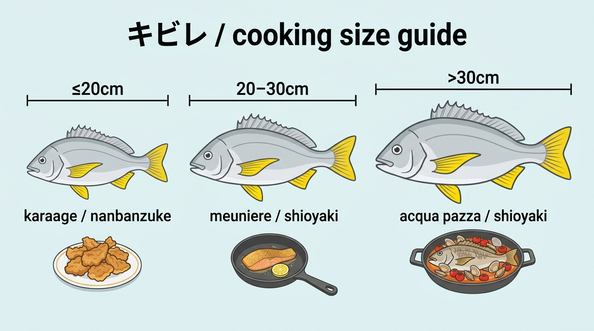

import BlogCard from "@components/BlogCard.astro";
import TackleCard from "@components/TackleCard.astro";

浜名湖で一年を通してアタリをくれる<strong>キビレ（キチヌ）</strong>。

クロダイ狙いの外道として扱われることも多いですが、食べ方を知っていると「また釣りたい」と思うほど美味しい魚です。

**結論から言うと：キビレは臭みが出にくく、サイズに合わせた調理法で誰でも美味しく食べられます。**

| サイズ | おすすめ調理法 |
|--------|----------------|
| 〜20cm（小型） | 唐揚げ・南蛮漬け（骨ごと食べられる） |
| 20〜30cm（中型） | ムニエル・塩焼き |
| 30cm〜（大型） | アクアパッツァ・塩焼き・ムニエル |

<strong>刺身はおすすめしません。</strong>キビレには寄生虫のリスクがあり、特に奥浜名湖で釣れた個体はリスクが高いので、中心まで火を通して食べてください。

**美味しさを決める下処理の要点：**
1. 釣れたらすぐ**血抜き**（臭みの元を流す）
2. 持ち帰り後に**脱水シートで熟成**（旨みと甘みがアップ）

この2ステップで、キビレの美味しさが大きく変わります。以下では各手順とレシピを詳しく解説します。

浜名湖でキビレが釣れるポイントはこちら。

<BlogCard slug="kibire-points" />

---

## キビレは年中釣れるからこそ、味の違いを知っておきたい

キビレの魅力は、なんといっても<strong>適水温の幅が広いこと</strong>です。

クロダイよりも低水温に強く、12℃前後の冬でも口を使ってくれるため、浜名湖では一年を通して釣果が出やすい魚です。

ただし、季節によって身の状態はかなり変わります。

<strong>春（入湖期）</strong>は外海から群れが入ってくる時期で、活性は高いものの、産卵を控えた個体は身がやや水っぽく感じることがあります。

<strong>夏</strong>は浅場のシャローフラットに広く分散し、数釣りが楽しめる反面、水温が高いぶん身が緩みやすいので持ち帰り方に注意が必要です。

<strong>秋（乗っ込み・産卵期）</strong>は荒食いの時期で、エサをたっぷり食べた個体は脂のりも良く、サイズも期待できます。

<strong>冬</strong>は深場へ落ちますが、2月以降のバチ抜けパターンで釣れる個体は身が締まっており、塩焼きやムニエルでも身崩れしにくくなります。

つまり、<strong>「いつ釣れたキビレか」で最適な食べ方が変わる</strong>というのが、キビレ料理を楽しむうえでの最大のポイントです。

---

## 美味しく食べるための下処理

キビレはクロダイに比べてエサが甲殻類（エビ・カニ）や小魚中心のため、磯臭さは出にくい魚です。

とはいえ、処理を怠ると魚特有の生臭さが出てしまうのは他の魚と同じです。

### 釣り場でのひと手間：血抜き

釣れたらすぐにエラ蓋を開き、エラの付け根に包丁やハサミを入れて血を抜きます。

血抜きをした魚はバケツの海水に5分ほど浸け、血を完全に流してからクーラーボックスへ移してください。

この一手間だけで、家に帰ってからの臭みがまったく違います。

ただ、暴れる魚を押さえながらエラの付け根に包丁の刃先を入れるのは、慣れないと手を切りやすい作業です。

包丁の扱いが苦手な人や、けがを避けたい人は、エラの付け根を刃で挟んで切れるキッチンバサミのほうが安全に作業できます。

選ぶなら、刃先まで力が伝わってエラを一度で切れること、海水や血がついても丸洗いできるステンレス製であることを確かめてください。

その条件で選ぶなら、ヒレ落としや内臓の処理にも使えるこのキッチンバサミが一つの候補です。

<TackleCard id="cooking/shimomura-verdun-scissors" />

包丁でのエラ切りに慣れている人は、手持ちの包丁で十分です。

### 大型は神経締めも有効

30cmを超えるような良型が釣れ、翌日以降に食べたい日は、血抜きに加えて神経締めをしておくと身質が長持ちします。

締めたあとも背骨の上の神経が生きていると、身が細かく動き続けて旨みのもとを使い、身が早く硬くなって傷みやすくなるためです。

尾の付け根から専用ワイヤーを通すだけの作業なので、慣れれば1分もかかりません。

道具は、良型の尾の付け根から頭の近くまで届く長さのワイヤーと、締めるときに使うピックがそろっているものを選びます。

その条件で選ぶなら、ロングタイプのワイヤーが入ったこのセットが一つの候補です。

<TackleCard id="cooking/lumica-ikijime-set" />

20cm前後のキビレを唐揚げにする日や、釣ったその日に食べる日は、血抜きだけで足ります。

### 持ち帰り後の「熟成」でさらに甘みアップ

捌いたあとの身は、キッチンペーパーで水気を拭き取り、脱水シートに包んで冷蔵庫で半日〜1日寝かせると、旨み・甘みが増します。

身の表面に残った水分は臭みの元になりやすく、ラップで包むだけでは抜けません。

特に夏場の身が緩みやすい個体には効果的なので、身に貼り付けたまま冷蔵庫で寝かせられる脱水シートを使ってみてください。

頻繁に魚を捌くなら、ロールで必要な長さだけ切って使える業務用が使いやすいです。

<TackleCard id="cooking/okamoto-pichit-regular-32" />

唐揚げや塩焼きにしてその日のうちに食べるなら、キッチンペーパーで水気を拭くだけで十分です。

---

## キビレの絶品レシピ集

キビレを捌くのは、家にある万能包丁で足ります。刺身にしない魚なので、刺身包丁まで用意する必要はありません。

### 1. 小〜中型のド定番「キビレの唐揚げ・南蛮漬け」

20cm前後までの小〜中型は、骨ごと食べられる唐揚げが一番のおすすめです。

**材料（2〜3人分）**：キビレ（三枚おろしまたはぶつ切り）2匹分、塩・コショウ、片栗粉、揚げ油

**作り方：**

1. キビレを一口大に切り、塩・コショウで下味をつけます。

2. 片栗粉をまぶし、170℃の油でカリッと2度揚げします。

3. 甘酢（酢・砂糖・醤油・みりんを煮詰めたもの）に揚げたてを絡めれば「南蛮漬け」に早変わりです。

骨の硬い部分が気になる場合は、二度揚げの時間を少し長めにすると、骨まで香ばしく食べられます。

### 2. クロダイより甘い身を活かす「キビレのムニエル」

中〜大型のキビレは、洋風の調理法が驚くほどよく合います。

**材料（2人分）**：キビレ（三枚おろし）2切れ、塩・コショウ、薄力粉、バター、オリーブオイル、レモン、パセリ

**作り方：**

1. 身に塩・コショウをして10分置き、出てきた水分をしっかり拭き取ります。

2. 薄力粉を薄くまぶします。

3. フライパンにオリーブオイルを熱し、皮目から焼き始めます。

4. 皮がパリッとしてきたら裏返し、バターを加えて全体に風味を絡めます。

5. レモンを絞り、パセリを散らして完成です。

キビレ特有の柔らかい身とバターの香りが合わさり、初めて食べた方は「これが外道？」と驚く一皿になります。

### 3. 良型なら「キビレのアクアパッツァ」

産卵期の秋に釣れる良型キビレは、丸ごと一尾使ったアクアパッツァがおすすめです。

オリーブオイル・ニンニク・白ワイン・あさり・ミニトマトと一緒にフライパンで蒸し焼きにするだけで、見映えのする一皿が完成します。

身からじんわり出る旨みがスープに溶け込み、バゲットを浸して食べると最高です。

### 4. キビレの刺身はおすすめしない。冬の締まった身も加熱で

私は、キビレを刺身で食べることをおすすめしません。

キビレには寄生虫のリスクがあり、特に奥浜名湖で釣れた個体はリスクが高いからです。

2月以降のバチ抜け期に釣れる身の締まった個体でも、塩焼き・ムニエル・アクアパッツァのように中心まで火を通して食べてください。

昆布締めも生で食べる料理なので、キビレでは同じ理由ですすめません。

刺身を楽しみたい日は、クロダイの料理記事で薄造りの作り方を紹介しています。

<BlogCard slug="kurodai-cooking" />

### 5. 釣りたての夜にすぐできる「キビレの塩焼き」

両面に多めの塩を振って20〜30分置き、出てきた水分を拭き取ってからグリルで焼くだけのシンプルな一品です。

塩を振ることで余分な水分と臭みが抜け、皮目はパリッと、身はふっくら仕上がります。

釣行から帰ってすぐ、火を使うだけで一品完成するので、忙しい日にも重宝します。

---

## サイズ・季節で選ぶ、キビレの食べ方早見表

**季節による使い分け：**

- <strong>夏に釣れた個体</strong>：身が緩みやすいので、揚げ物や熟成してからの料理が安心。

- <strong>冬〜春に釣れた個体</strong>：身が締まっているので、塩焼きやムニエルでも身崩れしにくいです。刺身にはせず、火を通してください。

---

## よくある疑問

### Q：クロダイとキビレ、味の違いは？

私の感覚では、<strong>クロダイは上品な白身、キビレはそれよりもやや脂があって甘みを感じる</strong>身質です。

クロダイのレシピで紹介した塩焼きや鯛飯のような料理も、キビレで作るとまた違った美味しさを楽しめます。

<BlogCard slug="kurodai-cooking" />

### Q：小さいサイズでも美味しく食べられますか？

15cm前後のキビレでも、唐揚げにすれば骨ごと美味しく食べられます。

数釣りで小型がたくさん釣れた日は、まとめて南蛮漬けにして作り置きにするのもおすすめです。

---

## まとめ：「外道」で終わらせるのはもったいない

キビレは浜名湖で一年中チャンスのあるターゲットでありながら、料理面ではクロダイの陰に隠れがちな存在です。

しかし、下処理さえきちんと行えば、唐揚げからムニエル、アクアパッツァまで幅広く楽しめる優秀な食材です。

次にキビレが釣れたら、ぜひクーラーボックスに大切に入れて持ち帰り、今回紹介したレシピを試してみてください。

きっと「キビレ、思ったより美味しいじゃないか」と感じていただけるはずです。

<BlogCard slug="kibire-beginner" />

<BlogCard slug="kibire-points" />
