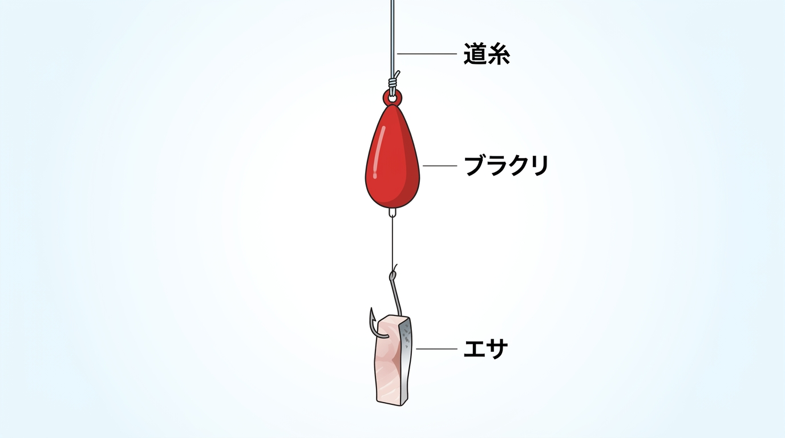

import BlogCard from "@components/BlogCard.astro";
import TackleCard from "@components/TackleCard.astro";

冬の浜名湖で「寒いけれど、少しだけ竿を出したい」なら、<strong>カサゴの穴釣り・探り釣り</strong>が候補になります。

特別な遠投や難しいアクションは必要ありません。

足元の隙間に仕掛けを落とし、「プルプルッ」という小気味良い引きを楽しむ、シンプルで奥が深い釣りです。

冬は比較的暖かい昼に出て、<strong>1〜2時間で切り上げる</strong>予定にすれば、暗くなって冷え込む前に帰れます。

初めての一匹を狙うなら、釣れる数より足場を優先し、明るい時間に護岸の際から始めるのが安心です。

## この記事で分かること

- <strong>仕掛け</strong>：短い竿＋ブラクリ（オモリと針を組み合わせた仕掛け）が基本
- <strong>エサ</strong>：まずはサバの切り身、エサ持ちならイカ、動きで誘うならアオイソメ
- <strong>狙う場所</strong>：安全な護岸から届く石積みの隙間や壁際
- <strong>釣行計画</strong>：通年狙え、冬は日中の短時間釣行にも向く

---

## カサゴとは？浜名湖における「鉄板魚」

カサゴは「根魚（ロックフィッシュ）」と呼ばれる底生魚です。

テトラポットの隙間や護岸の穴、石積みの間など、身を隠せる「根」に居着く習性があります。

一度縄張りを決めたら、そこからあまり移動しません。

そのため「釣り人が仕掛けをその魚の目の前に届けてあげる」ことが最大のコツです。

白身で上品な味わいがあり、釣れたら美味しい食材になるのも魅力です。

---

## いつ釣れる？カサゴのシーズン

カサゴは<strong>通年狙える魚</strong>で、冬も足元の隠れ場所を探って狙えます。

| 季節 | 釣果の目安 |
|---|---|
| 春 | 水温が上がる時期は、穴の周囲も探る |
| 夏 | 日中は日陰や隙間を探り、暑さを避ける |
| 秋 | 護岸の際や石積みを移動しながら探る |
| 冬 | 穴の奥へエサを届け、日中の短時間で組み立てる |

ただし、冬なら必ず釣れるわけではありません。

長く待ち続けるよりも、反応のある隙間を探すつもりで釣ると、短時間でもやることが明確になります。

冬のポイント選びと探り方を詳しく知りたい方は、こちらで釣行の流れを確認できます。

<BlogCard slug="winter-anazuri-guide-2026" />

---

## カサゴの穴釣り・探り釣りとは？

### 穴釣り

テトラポットや石積みの「穴」に直接仕掛けを落とす方法です。

穴の中に住んでいるカサゴの目の前にエサを届けます。

### 探り釣り

護岸や壁際、ケーソンの継ぎ目を歩きながら丁寧に探っていく方法です。

仕掛けを回収してから「次の穴」へ移動することで、広い範囲のカサゴを効率よく探せます。

どちらも仕掛けをカサゴの「目の前」に届けることが最大のコツです。

---

## 準備する道具（タックル）

最初に揃えるのは、短い竿・小型リール・道糸・ブラクリ・エサです。

すでに道具があるなら、買い替える前に竿の適合オモリ負荷とリールの組み合わせを確認しましょう。

### ロッド（竿）

穴釣りは遠投しないので、竿先を足元の狙い所へ向けやすい短竿が扱いやすいです。

ただし、短ければどこでも届くわけではなく、柵を越えて身を乗り出さずに釣れる長さを選びます。

| 選ぶ基準 | 候補 | 向く場面 |
|---|---|---|
| まず基本の一本を揃える | ダイワ穴釣り専科M110（1.11m） | 足元の穴と護岸際を探る |
| 近い隙間への取り回しを優先する | FIVE STARキワっ子90（90cm） | 安定した足場のすぐ近くを狙う |

冬の浜名湖でカサゴの穴釣りを始めるなら、長い投げ竿より、足元で糸を出し入れしやすい専用短竿が基本になります。

護岸際も探りたいのに短さだけで決めると届く範囲が狭くなるため、最初の候補は1.11mのダイワ穴釣り専科M110です。

スピニング・両軸の両方式に対応するので、手持ちの小型リールを活かしたい人にも選びやすい一本です。

<TackleCard id="winter/daiwa-anazuri-senka" position="tackle" />

一方、新居海釣公園などで、安全な足場のすぐ下に届く隙間を探るなら、90cmのキワっ子も比較候補です。

狙う範囲を足元に絞ることで竿先の移動を小さくできますが、柵や護岸の張り出しがある場所では短すぎることもあります。

冬のカサゴの穴釣り用としては、届かない穴を追って前へ出ず、立った位置から届く範囲に限って使う選択です。

<TackleCard id="winter/fivestar-kiwakko" position="tackle" />

長さ・対応リールは[ダイワ公式仕様](https://www.daiwa.com/jp/product/2023/05/09/09/31/w7m7qxv)、キワっ子90の製品情報は[FIVE STAR STORE](https://store.shopping.yahoo.co.jp/fivestarfishing/4523048251433.html)で確認できます。

### リール

小型のスピニングリールやベイトリールを使います。

糸の出し入れがしやすければ、どちらでも構いません。

竿によって対応するリールが異なるので、購入前に確認してください。

初めて使うリールは、釣り場へ行く前に糸を出す・止める・巻く操作を試しておくと安心です。

### ライン（道糸）

ナイロン3号前後を使います。

根ズレ（テトラや岩に糸がこすれること）が多いため、強度のあるラインが安心です。

回収した糸がザラついていたら傷んだ部分を切り、仕掛けを結び直してください。

### 忘れやすい小物

- <strong>針外し・魚をつかむ道具</strong>：カサゴの棘を避け、短時間で針を外すため
- <strong>ハサミ・予備のブラクリ</strong>：糸の傷や根掛かりに対応するため
- <strong>ライフジャケット・滑りにくい靴</strong>：足場がよい場所でも着用するため
- <strong>エサ容器・保冷材・クーラー</strong>：エサと、持ち帰る魚を冷やすため
- <strong>タオル・ゴミ袋</strong>：手を拭き、切った糸やエサの包装を持ち帰るため

---

## 仕掛け：ブラクリの選び方

ブラクリは、オモリと針が短い糸でつながった、穴釣りの基本仕掛けです。

道糸をブラクリ上部の接続部に結び、針にエサを付ければ釣りを始められます。

選ぶ目安は<strong>竿の適合オモリ負荷の範囲内で、底に着いたことが分かる重さ</strong>です。

流されて狙った穴に入らないなら重さを見直し、潮が速くて仕掛けを制御できない場合は釣る場所や時間を変えてください。

冬のカサゴの穴釣りでは、複雑な仕掛けを組むより、まずブラクリで足元へまっすぐエサを届ける練習から始めましょう。

石積みや護岸際は針や糸が傷みやすく、予備がないと根掛かり一度で釣りを終えることになります。

オーナーのあいなめブラクリを候補に、購入画面で号数を確認し、同じ重さの予備と重さを変えたものを揃えておくと対応しやすくなります。

<TackleCard id="mebaru-kasago/owner-ainame-brakuri" position="tackle" />

---

## おすすめのエサ

カサゴは食いしん坊なので、いろいろなエサに反応します。

初回は何種類も揃えず、付け直しやすいエサを一つ選び、足りなければ予備を足す形で十分です。

| エサ | 選ぶ理由 | 使うときの注意 |
|---|---|---|
| サバの切り身 | 匂いがあり、虫エサを触らずに使える | 大きすぎる切り身は小さく切る |
| イカの切り身・塩辛 | 針から外れにくく、付け直す回数を減らしやすい | 針先を隠さず、長いものは短くする |
| アオイソメ | 自然な動きで誘える | 弱ったり取られたりしたら付け直す |

### サバの切り身（一番おすすめ）

虫エサが苦手な人にも扱いやすく、匂いでアピールできます。

釣具店でパック売りされているものが便利です。

切り身を2cm×1cm程度の小さめにカットし、皮側から刺して針先を出します。

エサが針に団子状に固まると掛かりにくくなるため、回収するたびに形を確認しましょう。

### イカの塩辛・切り身

白く目立ち、身に張りがあるため、何度か落とし直すときにも使いやすいエサです。

家の冷蔵庫に余ったイカを持参しても使えます。

短冊が長い場合は、針のない端だけをかじられないよう小さく切ります。

塩辛を予備にする場合も密閉容器に入れ、サバと同じく保冷して持参してください。

### アオイソメ（青ジャムシ）

万能エサで、動きで誘いたいときに有効です。

スルスルと動く自然な動きが、カサゴの捕食本能を刺激します。

虫エサを扱えるなら、切り身で反応がないときに試す予備の選択肢になります。

どのエサも使う分だけ小分けに出し、残りは保冷容器で管理すると、付け替えるたびに荷物を広げずに済みます。

---

## 冬は手元を冷やさない準備も

1〜2時間の釣りでも、エサを付ける・糸を結ぶ作業では手元の防寒が必要です。

風を通しにくい上着と首元の防寒を整え、濡れた手はタオルで拭いてから手袋を着けましょう。

冬のカサゴの穴釣りはエサの付け直しが多く、厚い手袋では針や細い糸を扱いづらくなります。

毎回手袋を外す手間を減らすなら、親指・人差し指・中指の先が出る、裏起毛のUMIBOZU3フィンガーグローブが候補です。

露出する指先は冷えるので保温性を過信せず、購入画面で手に合うサイズを選んでください。

<TackleCard id="winter/umibozu-3finger-glove" position="safety" />

指がかじかんで針を安全に扱えなくなったら、予定時間にかかわらず釣りを切り上げましょう。

重ね着や足元まで含めた冬装備の揃え方は、防寒ガイドで確認できます。

<BlogCard slug="winter-cold-protection-guide" />

---

## 釣り方の手順：5ステップ

1. <strong>仕掛けを落とす</strong>：竿先を狙う隙間の上へ向け、糸の出方を指で調整しながら慎重に落とします。
2. <strong>底を取る</strong>：仕掛けが底に着いたら、余分な糸のたるみを取ります。
3. <strong>小さく誘って止める</strong>：底付近で竿先を小さく上下させ、動きを止めて反応を見ます。
4. <strong>アタリを捉える</strong>：竿先や手元に反応が来たら集中し、魚が掛かったら穴へ潜られないよう速やかに巻き上げます。
5. <strong>反応がなければ移動</strong>：着底と誘いを試しても反応がなければ、仕掛けを回収して次の穴へ移ります。

移動中は針をぶら下げず、周りの人と足元を確認してください。

---

## カサゴを探す3つのコツ

### 1. ラン＆ガン（即移動）が命

カサゴ穴釣りの最大の鉄則は「反応がなければ即移動」です。

着底と誘いを確かめてもアタリがなければ、次の穴へ移りましょう。

広い範囲を探ることで、居着きのカサゴを効率よく見つけられます。

### 2. 穴の「奥」まで届ける

入口だけを探るのでは、奥に隠れているカサゴにエサが届きません。

底に届くように糸を送りながら、落ち方と糸の変化を確認してください。

ただし、引っ掛かっている仕掛けを無理に押し込まず、届かない穴は見送りましょう。

### 3. 夕方〜夜がチャンス

日中は穴の奥に潜んでいるカサゴも、夕方になると餌を求めて外に出てきます。

夕方から釣る場合は、明るいうちに足場と帰り道を確認し、ライトを用意してください。

初回の冬釣行なら、夕方まで粘らず日中に終える計画で構いません。

<strong>ハンターの知恵袋：回収したエサも手掛かりです。</strong>
アタリがなくてもエサが取られていたら、付け方や大きさを見直してから次を探ると、同じ失敗を繰り返しにくくなります。

---

## 浜名湖の初心者おすすめポイント

まずはテトラに上がらずに釣れる護岸を選び、立入可能な範囲と当日の風を確認しましょう。

### 新居海釣り公園

T字堤の足元や継ぎ目を、身を乗り出さずに探る釣りから始められます。

柵がある場所でもライフジャケットを着用し、子どもから目を離さないでください。

釣り座や施設利用の注意点は、新居弁天海釣公園の記事で確認できます。

<BlogCard slug="araibenten-umiduripark" />

### 砂揚げ場（新居）

護岸沿いの継ぎ目を探るスタイルが向いていますが、柵がない岸壁なので水際へ近づきすぎないでください。

港の作業を優先し、作業中の岸壁・係留船・ロープの周囲は避けます。

利用できる範囲と注意点を確認してから、釣り座を選んでください。

<BlogCard slug="sunaageba" />

> [!CAUTION]
> テトラ上へ入り込まず、現地看板・施設のルール・漁協の最新案内に従ってください。
> 強風や波で足元が不安定な日は、短時間でも釣りを見送ります。

ほかのカサゴの狙い所やルアー釣りも比べたい方は、魚種別ガイドを入口にできます。

<BlogCard slug="kasago-guide" />

---

## 釣れたカサゴの扱い方

カサゴには<strong>背ビレに鋭い棘（とげ）</strong>があります。

背ビレを手で押さえようとせず、魚をつかむ道具で保持し、針外しを使ってください。

15cm以下の小さなカサゴは、資源保護の目安としてリリースをおすすめします。

これは本記事での推奨で、カサゴの法定採捕サイズを示すものではありません。

リリースするときは、ダメージを最小限にするために素早く水に戻してください。

> [!IMPORTANT]
> 穴釣りで全長13cm以下のウナギが掛かった場合は、持ち帰らず速やかに戻してください。
> 出典：[静岡県「海面における遊漁のルール」](https://www.pref.shizuoka.jp/sangyoshigoto/suisan/suisanshigen/1047550/1028113.html)（2026年11月5日確認）。

---

## まとめ：ボウズ知らずの「鉄板魚」を狙おう！

カサゴ釣りは、魚の隠れ場所へエサを届けることが基本です。

「今日はとにかく一匹釣りたい」「子どもに釣りを体験させてあげたい」そんな時は、迷わず穴釣りへ。

短い竿とブラクリ、扱いやすいエサを揃えたら、冬は明るい時間の1〜2時間から始めてみてください。

持ち帰る分は保冷し、<strong>煮付けや唐揚げ</strong>で楽しめます。

> [!TIP]
> <strong>根掛かりに備える</strong>
> 穴を攻める釣りはどうしても針が引っかかりやすいので、予備のブラクリを用意しましょう。
> 外そうとして身を乗り出さず、まず足場と周囲の安全を優先してください。

> [!CAUTION]
> 15cm以下の小さなカサゴは、将来のためにリリースをお願いします。

釣れたカサゴの下処理と煮付けの手順は、料理ガイドで確認できます。

<BlogCard slug="mebaru-kasago-cooking" />
